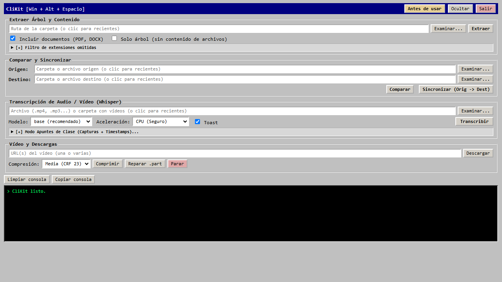
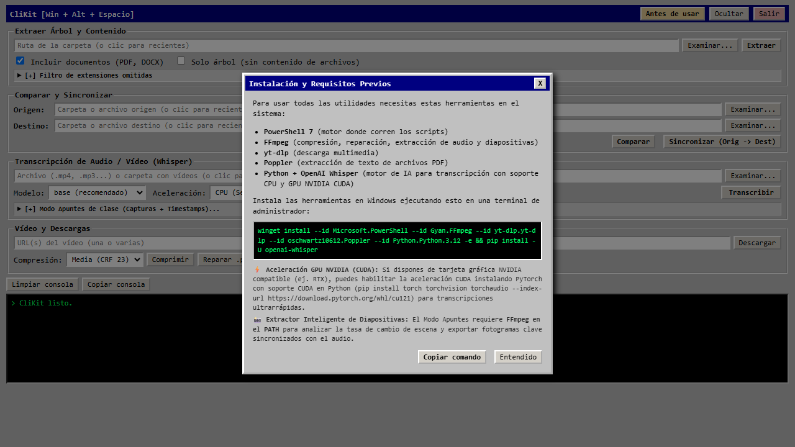
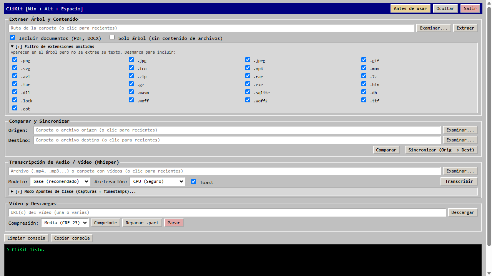
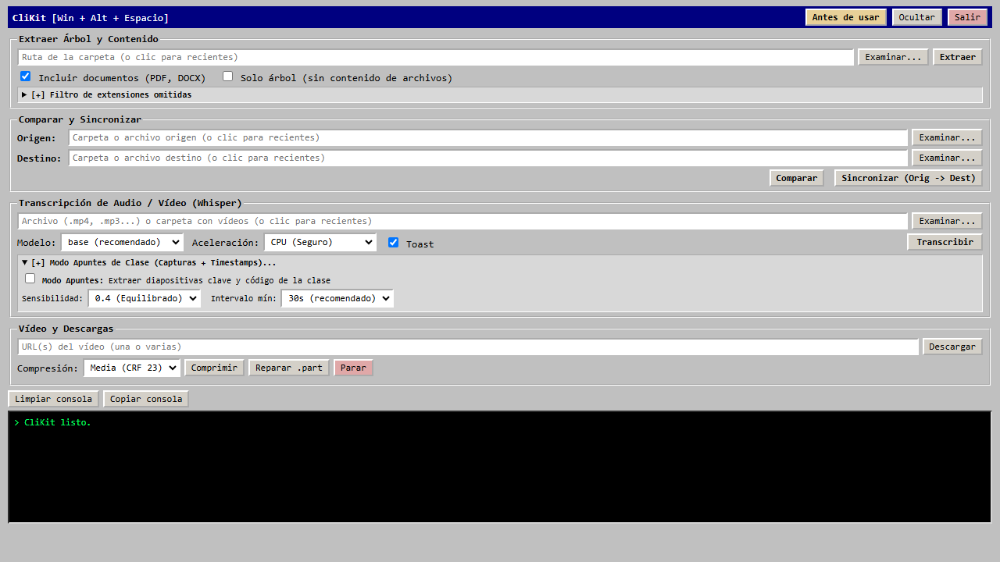
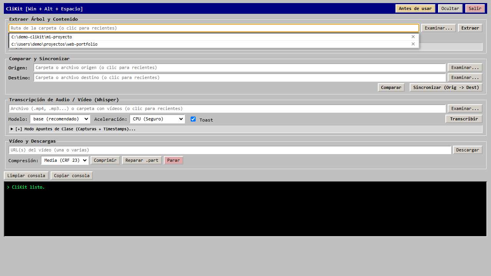
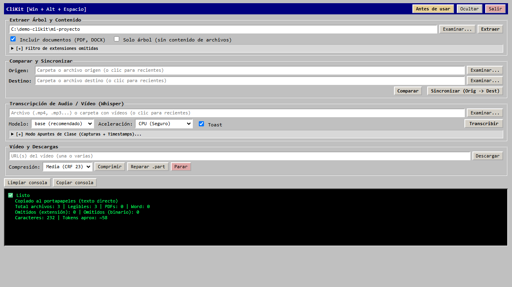
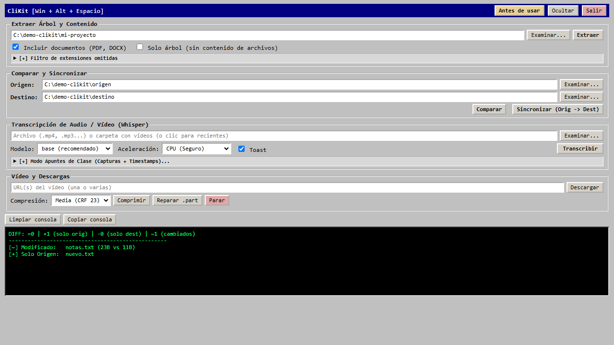
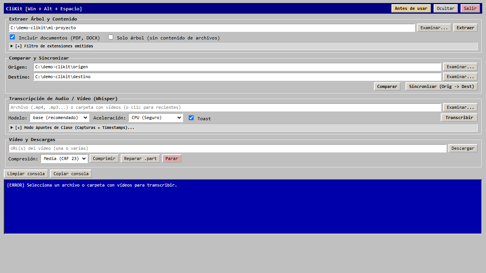
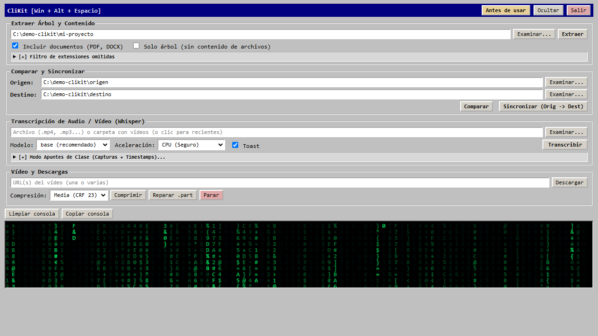
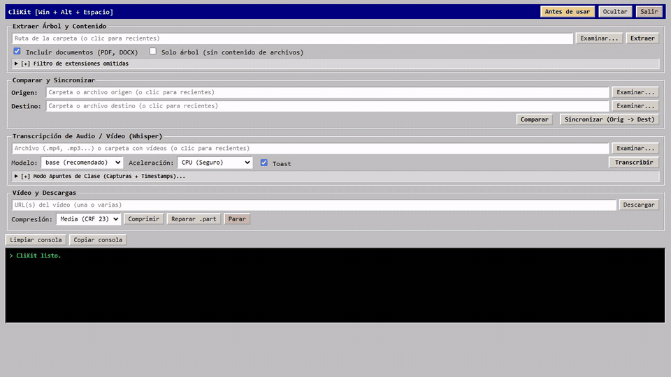

# CliKit

Una app de escritorio que automatiza comandos útiles de terminal.

## ¿Qué es esto?

Tengo un montón de comandos que uso constantemente: extraer el contenido de un proyecto para analizarlo, descargar vídeos, comprimir grabaciones, comparar carpetas antes de hacer un backup... 

CliKit es la solución que me monté para tenerlo todo en un sitio, un Kit a golpe de Click. Una ventana retro estilo Windows 98 que vive en la bandeja del sistema y aparece con **Win + Alt + Espacio**. 

---

## Qué hace

- **Extrae el árbol y contenido de cualquier carpeta**: pensado para extraer y copiar un proyecto entero para su posterior análisis. Soporta PDF y Word.
- **Compara y sincroniza carpetas**: ves qué archivos son distintos entre dos directorios y puedes sincronizarlos con un botón.
- **Descarga vídeos**: pega la URL y listo. Usa yt-dlp por debajo.
- **Comprime vídeos**: con ffmpeg en calidad baja/media/alta.
- **Descarga en lote**: copia varias URLs al portapapeles y las descarga todas en paralelo en segundo plano.

---

## Capturas

### 1. Pantalla principal

Todo en una sola ventana retro: extraer carpetas, comparar y sincronizar, transcribir audio/vídeo con Whisper y descargar o comprimir vídeo. Abajo, la consola con los resultados.

### 2. Antes de usar

Ventana con los requisitos (PowerShell 7, FFmpeg, yt-dlp, Poppler, Whisper) y un botón para copiar el comando de instalación.

### 3. Filtro de extensiones

Panel desplegable con las extensiones que no se leen (imágenes, binarios, comprimidos...). Se pueden marcar y desmarcar.

### 4. Modo Apuntes de Clase

Opciones para extraer diapositivas clave de un vídeo con su sensibilidad y el intervalo mínimo entre capturas.

### 5. Historial reciente

Al hacer clic en una ruta aparecen las últimas usadas, con una ✕ para quitar cada una.

### 6. Resultado de extraer

Tras extraer una carpeta, la consola resume archivos leídos, caracteres y tokens aproximados. El contenido queda copiado al portapapeles.

### 7. Comparar carpetas

Compara origen y destino y lista qué archivos han cambiado o solo existen en uno de los lados.

### 8. Estado de error

Si falta algo (por ejemplo, no hay archivo que transcribir) la consola se pone en azul con el mensaje del error. Un clic la devuelve a la normalidad.

### 9. Detalle oculto: efecto Matrix

Un doble clic en la consola (o escribir «matrix») activa una lluvia de caracteres. Escape o clic para salir.

## Recorrido en gif

## Stack

| Capa | Tecnología |
|---|---|
| App de escritorio | [Electron](https://www.electronjs.org/) |
| Comunicación UI ↔ backend | IPC asíncrono (`ipcMain` / `ipcRenderer`) con `contextBridge` |
| Scripting | PowerShell 7 ejecutado con `-EncodedCommand` (evita inyección) |
| Descarga multimedia | [yt-dlp](https://github.com/yt-dlp/yt-dlp) |
| Procesado de vídeo | [FFmpeg](https://ffmpeg.org/) |
| Extracción de PDF | [Poppler](https://poppler.freedesktop.org/) (`pdftotext`) |

